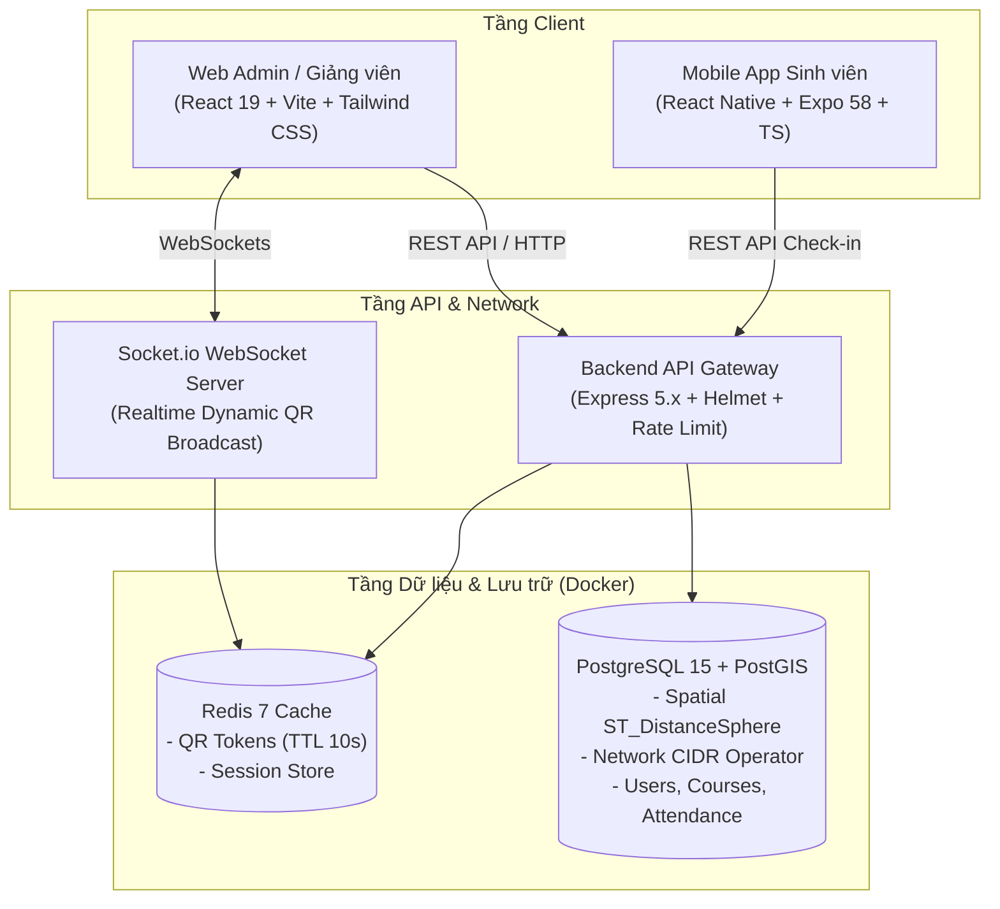

# 🎓 Smart Classroom Management System (SCMS)

> **Hệ thống Quản lý Lớp học & Điểm danh Thông minh Chống Gian lận Đa lớp**  
> Tích hợp: **Dynamic QR Code (Realtime WebSockets) + Định vị GPS (PostGIS) + Xác thực Wi-Fi IP (CIDR) + Khóa thiết bị (Device Binding) + Đơn xin nghỉ phép trực tuyến & Cảnh báo Cấm thi tự động.**

---

[](https://nodejs.org/)
[](https://expressjs.com/)
[](https://www.postgresql.org/)
[](https://postgis.net/)
[](https://redis.io/)
[](https://react.dev/)
[](https://expo.dev/)
[](https://www.docker.com/)
[](https://opensource.org/licenses/ISC)

---

## 📌 Mục Lục
1. [Giới Thiệu Dự Án](#-giới-thiệu-dự-án)
2. [Cơ Chế Chống Gian Lận 4 Lớp](#-cơ-chế-chống-gian-lận-4-lớp-cốt-lõi)
3. [Tính Năng Nổi Bật Theo Vai Trò](#-tính-năng-nổi-bật-theo-vai-trò)
4. [Kiến Trúc Hệ Thống (Architecture)](#-kiến-trúc-hệ-thống)
5. [Công Nghệ Sử Dụng (Tech Stack)](#-công-nghệ-sử-dụng-tech-stack)
6. [Cấu Trúc Thư Mục (Monorepo)](#-cấu-trúc-thư-mục-monorepo)
7. [Hướng Dẫn Cài Đặt & Khởi Chạy](#-hướng-dẫn-cài-đặt--khởi-chạy)
8. [Tài Khoản Thử Nghiệm Mẫu](#-tài-khoản-thử-nghiệm-mẫu)
9. [Tổng Hợp API Endpoints](#-tổng-hợp-api-endpoints)
10. [Nhật Ký Phát Triển & Đội Ngũ](#-nhật-ký-phát-triển--đội-ngũ)

---

## 📖 Giới Thiệu Dự Án

Trong các trường đại học và cơ sở giáo dục hiện nay, việc điểm danh truyền thống (điểm danh miệng, ký tên trên giấy) tốn rất nhiều thời gian tiết học và dễ xảy ra tình trạng "điểm danh hộ". Các hệ thống quét mã QR tĩnh thông thường cũng dễ dàng bị vượt qua bằng cách: chụp ảnh màn hình mã QR gửi qua Zalo/Messenger cho bạn bè đang ở nhà quét hộ, hoặc sử dụng phần mềm Fake GPS.

**Smart Classroom Management System (SCMS)** được phát triển nhằm giải quyết triệt để vấn đề trên. Dự án kết hợp sức mạnh của **Cơ sở dữ liệu Không gian (PostGIS)**, **Bộ nhớ tạm thời gian thực (Redis & WebSockets)** và **Định danh Phần cứng Di động** để tạo ra quy trình điểm danh hoàn toàn tự động, minh bạch và chống gian lận tối đa.

---

## 🛡️ Cơ Chế Chống Gian Lận 4 Lớp (Cốt Lõi)

Hệ thống thiết lập một hàng rào bảo mật 4 lớp khép kín:

```
[Máy chiếu GV: Dynamic QR (xoay vòng mỗi 10s)]
                     │
                     ▼
[Sinh viên dùng Mobile App quét QR & gửi Payload]
  ├─ 1. Token Check    ──> Token hợp lệ & chưa hết hạn (TTL 10s trong Redis)
  ├─ 2. Wi-Fi IP Check ──> IP sinh viên nằm trong CIDR Wi-Fi phòng học (PostgreSQL <<=)
  ├─ 3. GPS Check      ──> Khoảng cách SV đến bục giảng <= R (PostGIS ST_DistanceSphere)
  └─ 4. Device Binding ──> Đúng điện thoại duy nhất đã liên kết với tài khoản sinh viên
                     │
                     ▼
  [Xác nhận: PRESENT / LATE / INVALID_LOCATION]
```

1. **Lớp 1 — Dynamic QR Code (Mã QR động):**
   - Mã QR hiển thị trên màn hình máy chiếu tự động thay đổi sau mỗi **10 giây** thông qua Socket.io và Redis TTL.
   - Sinh viên trong lớp không thể chụp ảnh gửi ra ngoài vì mã sẽ hết hạn trước khi người ở nhà kịp quét.
2. **Lớp 2 — GPS Geolocation (Định vị phòng học bằng PostGIS):**
   - Hệ thống tính khoảng cách đường chim bay giữa tọa độ giảng viên (bục giảng) và tọa độ thiết bị sinh viên theo thuật toán Geodesic trên elipsoid chuẩn WGS 84 (`ST_DistanceSphere`).
   - Chỉ cho phép điểm danh thành công khi sinh viên ở trong bán kính cho phép (mặc định 50m - 100m).
3. **Lớp 3 — Wi-Fi IP CIDR Verification (Mạng nội bộ trường học):**
   - Xác thực địa chỉ IP của sinh viên phải thuộc dải mạng Wi-Fi phòng học bằng toán tử chuyên dụng `scanned_ip <<= ip_range` của PostgreSQL.
   - Ngăn chặn sinh viên dù đứng gần trường nhưng dùng 4G hoặc phát Wi-Fi riêng để gian lận.
4. **Lớp 4 — Device Binding (Khóa 1 tài khoản trên 1 thiết bị):**
   - Chặn đứng chiêu trò: *"Một sinh viên cầm 3-4 điện thoại của bạn bè vào lớp để quét hộ"*.
   - Lần đầu điểm danh, hệ thống tự động khóa mã UUID thiết bị (`device_id`) vào tài khoản sinh viên.
   - Nếu bạn bè đăng nhập tài khoản đó trên máy khác để quét hộ, Backend lập tức từ chối với lỗi **`403 Forbidden`**. Chỉ Quản trị viên (Admin) mới có quyền gỡ liên kết khi sinh viên đổi máy mới.

---

## ✨ Tính Năng Nổi Bật Theo Vai Trò

### 1. Quản Trị Viên (Administrator) — *Web Portal*
- **Quản lý người dùng toàn diện:**
  - Bộ lọc danh sách theo vai trò (`ADMIN`, `LECTURER`, `STUDENT`) kèm tìm kiếm đa năng theo họ tên, username, email.
  - Cấp tài khoản mới đơn lẻ trực tiếp.
  - **Import hàng loạt từ file Excel/CSV:** Nhận diện header linh hoạt cả tiếng Việt lẫn tiếng Anh, tự động đặt mật khẩu mặc định `123456`, bỏ qua dòng lỗi mà không ngắt chuỗi import.
  - **Quản trị bảo mật:** Đặt lại mật khẩu (Reset password), Khóa/Mở khóa tài khoản, Gỡ liên kết thiết bị (Device Unbinding).
- **Quản lý khóa học (Courses):**
  - Tạo, cập nhật, xóa môn học; Phân công giảng viên phụ trách.

### 2. Giảng Viên (Lecturer) — *Web Portal*
- **Quản lý lớp học phần:**
  - Cấu hình chỉ số đào tạo: Tổng số buổi học phần (`total_sessions`, mặc định 10-15 buổi) và Số buổi vắng tối đa cho phép (`max_absences`, mặc định 2 buổi).
  - Quản lý danh sách sinh viên ghi danh vào lớp (thêm/xóa hàng loạt sinh viên).
- **Mở phiên điểm danh thông minh theo Buổi học thực tế (Session Numbering):**
  - Giảng viên chủ động chọn cụ thể Buổi học cần mở (Buổi 1, Buổi 2... / Tổng số buổi) với huy hiệu nhận biết buổi đã học (`✓ Đã học`), đang mở (`🔥 Đang mở`) hoặc chưa học, kèm cảnh báo khi mở lại buổi cũ.
  - Trình duyệt tự động lấy tọa độ GPS hiện tại của giảng viên qua HTML5 Geolocation (không cần nhập kinh/vĩ độ thủ công).
  - Giảng viên chọn bán kính quét (ví dụ 50m) và thời gian tính đi muộn (Late).
  - Tự động duy trì và khôi phục phiên đang mở khi chuyển tab hoặc tải lại trang máy chiếu.
- **Màn hình Máy chiếu QR Realtime (Projector View):**
  - Màn hình Fullscreen chuyên dụng chiếu lên bảng, tự xoay vòng mã QR mỗi 10 giây kèm thanh đếm ngược.
  - Danh sách sinh viên điểm danh thành công được cập nhật nhảy số tức thì theo thời gian thực (qua WebSockets).
- **Duyệt Đơn xin nghỉ phép trực tuyến:**
  - Xem danh sách đơn xin nghỉ kèm lý do và ảnh minh chứng (giấy khám bệnh, giấy triệu tập...).
  - Thao tác Duyệt (`APPROVED`) hoặc Từ chối (`REJECTED`): Khi duyệt, hệ thống tự động đồng bộ buổi học đó thành trạng thái **`EXCUSED` (Nghỉ có phép)**, không tính vào số buổi vắng không phép.
- **Thống kê & Báo cáo Điểm danh (Analytics & Sổ Điểm danh Chi tiết):**
  - **Lộ trình buổi học (Roadmap Cards):** Hiển thị thẻ từng buổi học trực quan theo tiến độ học phần.
  - **Sổ Điểm danh Chi tiết từng buổi (Modal Popup):** Click vào từng buổi học để mở danh sách 100% sinh viên lớp, phân loại 5 trạng thái: Có mặt (`PRESENT`), Đi muộn (`LATE`), Nghỉ có phép (`EXCUSED`), Vi phạm vị trí (`INVALID_LOCATION`), Vắng không phép (`ABSENT`), kèm bộ lọc nhanh, tìm kiếm sinh viên, khoảng cách GPS và IP.
  - **Cảnh báo Cấm thi tự động:** Tự động gắn nhãn đỏ **`CẤM THI`** khi `absent_count > max_absences`.
  - Xuất báo cáo bảng điểm danh ra file Excel/CSV chuẩn mã hóa UTF-8 kèm BOM.

### 3. Sinh Viên (Student) — *Mobile App*
- **Đăng nhập & Lưu phiên an toàn:** Lưu trữ token bảo mật bằng SecureStore/Keychain.
- **Điểm danh 1 chạm:** Mở camera quét mã QR trên máy chiếu; App tự động đính kèm GPS tọa độ thực tế, IP mạng và Device UUID để đối soát.
- **Xem Lịch sử điểm danh theo Lộ trình:** Theo dõi chi tiết lịch sử môn học theo buổi (`[Mã môn] · Buổi X / Y`), thời gian quét mã, thời gian duyệt đơn nghỉ phép, trạng thái hiển thị huy hiệu màu đồng bộ 100% với Web (Có mặt, Đi muộn, Nghỉ có phép, Vắng, Lỗi vị trí).
- **Gửi Đơn xin nghỉ phép trực tuyến:**
  - Chọn môn học, chọn ngày nghỉ dự kiến.
  - Nhập lý do và chụp/đính kèm ảnh minh chứng từ máy ảnh hoặc thư viện ảnh.
  - Theo dõi trạng thái đơn (`PENDING`, `APPROVED`, `REJECTED`) kèm lời nhắn phản hồi của giảng viên.

---

## 🏗️ Kiến Trúc Hệ Thống



---

## 💻 Công Nghệ Sử Dụng (Tech Stack)

| Thành phần | Công nghệ / Thư viện | Vai trò |
|---|---|---|
| **Backend Core** | Node.js (v18+), Express 5 | Xây dựng RESTful API Server theo kiến trúc Layered (Route - Controller - Service - Model) |
| **Database** | PostgreSQL 15, PostGIS 3.3 | Lưu trữ dữ liệu quan hệ, tính toán khoảng cách không gian địa lý (`ST_DistanceSphere`) và đối soát IP CIDR (`<<=`) |
| **Cache & Realtime**| Redis 7, Socket.io 4.8 | Sinh và kiểm tra QR Token xoay vòng (TTL 10s), đẩy thông báo điểm danh realtime |
| **Security & Auth** | JWT, BcryptJS, Helmet, Express-Rate-Limit | Xác thực người dùng, mã hóa mật khẩu, phân quyền RBAC và chống spam/DDoS |
| **Database Migration** | db-migrate, db-migrate-pg | Quản lý phiên bản cấu trúc database, đảm bảo khả năng Rollback / Migration nhất quán |
| **Frontend Web** | React 19, Vite 8, Tailwind CSS v4, Lucide React, Axios, React Router 7 | Giao diện quản trị, máy chiếu QR, dashboard báo cáo và quản lý người dùng |
| **Frontend Mobile** | React Native, Expo 58, TypeScript, Expo Camera, Expo Location, SecureStore | Ứng dụng di động dành cho sinh viên quét mã, lấy vị trí GPS và định danh thiết bị |
| **DevOps / Container**| Docker, Docker Compose | Đóng gói toàn bộ cơ sở hạ tầng (Postgres PostGIS, Redis, Backend) chạy nhất quán |

---

## 📁 Cấu Trúc Thư Mục (Monorepo)

```bash
Smart-Classroom-Management-System/
├── backend/                        # RESTful API Server (Node.js/Express)
│   ├── migrations/                 # Migration scripts (db-migrate)
│   │   └── sqls/                   # File SQL Up/Down cho từng phiên bản
│   ├── scripts/                    # Scripts tiện ích (Seed Admin...)
│   └── src/
│       ├── config/                 # Cấu hình DB, Redis, JWT, Session
│       ├── constants/              # Khai báo hằng số (Roles, Status...)
│       ├── controllers/            # Tầng Controller (tiếp nhận HTTP Request)
│       ├── middlewares/            # Auth, Error Handler, Phân quyền RBAC
│       ├── models/                 # Tầng Data Access (SQL queries parameterized)
│       ├── routes/                 # Định nghĩa các API Endpoints
│       ├── services/               # Tầng Nghiệp vụ cốt lõi (Business Logic)
│       ├── utils/                  # AppError, Response Helper, Geo/Network math
│       ├── app.js                  # Express app setup & middlewares
│       └── server.js               # Server entry point & Socket.io init
├── frontend-web/                   # Web Application (Admin & Giảng viên)
│   ├── src/
│   │   ├── api/                    # Axios clients & API services
│   │   ├── components/             # UI Components dùng chung
│   │   ├── pages/                  # Login, Courses, QR Projector, Reports, Users...
│   │   ├── App.jsx                 # Cấu hình Route chính
│   │   └── main.jsx
│   └── vite.config.js
├── frontend-mobile/                # Mobile Application (Sinh viên)
│   ├── screens/                    # Login, Home, QR Scanner, History, Leave Request...
│   ├── apiConfig.ts                # Cấu hình IP kết nối API
│   ├── App.tsx                     # Entry point Expo Navigation
│   └── package.json
├── docs/                           # Tài liệu dự án
│   └── tasks/                      # Nhật ký chi tiết từng Task (T001 -> T019)
├── docker-compose.yml              # Cấu hình Docker cho Postgres PostGIS, Redis, Backend
├── PROJECT_CONTEXT.md              # Bối cảnh nghiệp vụ và quy tắc code
└── README.md                       # Tài liệu chính của dự án
```

---

## 🚀 Hướng Dẫn Cài Đặt & Khởi Chạy

### 1. Yêu cầu môi trường
- [Node.js](https://nodejs.org/) version **18.x** hoặc **20.x trở lên**
- [Docker Desktop](https://www.docker.com/) (để chạy PostgreSQL PostGIS và Redis)
- [Git](https://git-scm.com/)
- [Expo Go App](https://expo.dev/go) trên điện thoại (để chạy thử Mobile App)

---

### 2. Khởi động Cơ sở dữ liệu & Redis (Bằng Docker)

Dự án đã đóng gói sẵn Docker Compose. Mở terminal tại thư mục gốc và chạy:

```bash
docker compose up -d postgres redis
```

Kiểm tra trạng thái container:
```bash
docker ps
# Bạn sẽ thấy smartclass-postgres (port 5432) và smartclass-redis (port 6379) đang chạy
```

---

### 3. Cài đặt & Chạy Backend API

```bash
# 1. Di chuyển vào thư mục backend
cd backend

# 2. Cài đặt dependencies
npm install

# 3. Tạo file cấu hình môi trường .env (nếu chưa có)
cp .env.example .env

# 4. Chạy Migration để khởi tạo cấu trúc CSDL
npm run migrate

# 5. Khởi tạo tài khoản Quản trị viên ban đầu
npm run seed:admin

# 6. Khởi động Backend ở chế độ phát triển
npm run dev
```
> Server sẽ lắng nghe tại: `http://localhost:3000` (hoặc `http://<IP_MÁY_BẠN>:3000`).

---

### 4. Cài đặt & Chạy Frontend Web (Dành cho Giảng viên & Admin)

Mở một cửa sổ terminal mới:

```bash
# 1. Di chuyển vào thư mục web
cd frontend-web

# 2. Cài đặt dependencies
npm install

# 3. Khởi động Web Server
npm run dev
```
> Mở trình duyệt và truy cập: `http://localhost:5173`

---

### 5. Cài đặt & Chạy Frontend Mobile (Dành cho Sinh viên)

Mở một cửa sổ terminal mới:

```bash
# 1. Di chuyển vào thư mục mobile
cd frontend-mobile

# 2. Cài đặt dependencies
npm install

# 3. Cập nhật IP máy tính của bạn trong file frontend-mobile/apiConfig.ts
# Ví dụ: export const API_BASE_URL = 'http://192.168.1.100:3000/api';

# 4. Khởi động Expo Server
npm start
```
> Quét mã QR hiển thị trên terminal bằng ứng dụng **Expo Go** trên điện thoại Android/iOS của bạn để chạy ứng dụng.

---

## 🔑 Tài Khoản Thử Nghiệm Mẫu

Sau khi chạy lệnh `npm run seed:admin` và hệ thống khởi tạo, bạn có thể sử dụng các tài khoản sau để đăng nhập kiểm thử:

| Vai trò (Role) | Username | Password mặc định | Ghi chú |
|---|---|---|---|
| **Quản trị viên (ADMIN)** | `admin` | `1234567890` (hoặc cấu hình trong `.env`) | Toàn quyền quản trị hệ thống, cấp tài khoản, import CSV, cấu hình môn học |
| **Giảng viên (LECTURER)** | `gv01` | `123456` | Quản lý lớp học phần, mở máy chiếu QR, duyệt đơn xin nghỉ, xuất báo cáo |
| **Sinh viên (STUDENT)** | `sv01` | `123456` | Đăng nhập trên Mobile, quét mã QR điểm danh, gửi đơn xin nghỉ phép |

---

## 📡 Tổng Hợp API Endpoints Chính

Tất cả các API trả về theo chuẩn JSON thống nhất:
```json
{
  "status": "success",
  "message": "Thông báo kết quả thao tác",
  "data": { ... }
}
```

### 1. Xác thực & Phân quyền (Auth)
- `POST /api/auth/register` — Đăng ký tài khoản (chỉ STUDENT hoặc LECTURER).
- `POST /api/auth/login` — Đăng nhập, nhận JWT Token.
- `GET  /api/auth/me` — Lấy thông tin tài khoản hiện tại.

### 2. Quản trị Người Dùng (Admin & RBAC)
- `GET   /api/users` — Lấy danh sách users (hỗ trợ lọc `?role=...` và tìm kiếm `?search=...`).
- `POST  /api/users` — Admin cấp tài khoản mới kèm họ tên, email.
- `POST  /api/users/import-csv` — Admin import tài khoản hàng loạt từ file Excel/CSV.
- `POST  /api/users/:id/reset-password` — Đặt lại mật khẩu về mặc định `123456`.
- `POST  /api/users/:id/unbind-device` — Hủy liên kết thiết bị khóa (Device Unbinding).
- `PATCH /api/users/:id/toggle-lock` — Khóa hoặc mở khóa tài khoản.

### 3. Khóa học & Lớp học phần (Courses & Enrollments)
- `GET    /api/courses` — Danh sách môn học theo phân quyền.
- `POST   /api/courses` — Tạo môn học mới (cấu hình `totalSessions`, `maxAbsences`).
- `PATCH  /api/courses/:id` — Cập nhật môn học.
- `DELETE /api/courses/:id` — Xóa môn học (Admin).
- `GET    /api/courses/:id/students` — Danh sách sinh viên trong lớp.
- `POST   /api/courses/:id/students` — Ghi danh sinh viên vào lớp theo danh sách `usernames`.

### 4. Phiên Điểm Danh & QR Code (Sessions & Attendance)
- `POST /api/courses/:id/sessions` — Giảng viên mở phiên điểm danh (truyền GPS bục giảng, bán kính, thời gian muộn). Tự động liên kết các đơn nghỉ phép đã duyệt.
- `POST /api/sessions/:sessionId/close` — Đóng sớm phiên điểm danh.
- `POST /api/attendance/checkin` — Sinh viên gửi mã QR token, GPS, IP và `deviceId` để điểm danh chống gian lận.

### 5. Đơn Xin Nghỉ Phép Trực Tuyến (Leave Requests)
- `POST  /api/leave-requests` — Sinh viên nộp đơn xin nghỉ kèm ngày nghỉ, lý do và ảnh minh chứng.
- `GET   /api/leave-requests` — Danh sách đơn xin nghỉ (tự động lọc theo quyền).
- `GET   /api/leave-requests/course/:courseId` — Giảng viên xem đơn xin nghỉ của môn mình dạy.
- `PATCH /api/leave-requests/:id` — Giảng viên Duyệt (`APPROVED`) hoặc Từ chối (`REJECTED`) đơn. Tự động cập nhật bản ghi điểm danh thành `EXCUSED`.

### 6. Báo Cáo & Cảnh Báo Cấm Thi (Reports & Analytics)
- `GET /api/reports/courses/:courseId` — Báo cáo thống kê điểm danh toàn lớp, tự động tính cờ `is_banned: true/false`.
- `GET /api/reports/courses/:courseId/export` — Xuất file CSV báo cáo điểm danh kèm cột trạng thái Cấm thi.
- `GET /api/reports/me` — Sinh viên tự xem lịch sử điểm danh của bản thân.

---

## 👥 Đội Ngũ Phát Triển (Team)

Dự án được xây dựng và duy trì bởi nhóm 3 thành viên:

| Thành viên | Vai trò | Trách nhiệm chính |
|---|---|---|
| **Cường** | **Backend / DevOps Lead** | Kiến trúc cơ sở dữ liệu (PostGIS), RESTful API, Redis & WebSocket Realtime, Thuật toán đối soát vị trí GPS/IP, Khóa thiết bị (Device Binding), Docker & CI/CD. |
| **Thư** | **Frontend Web / BA Lead** | Phân tích yêu cầu nghiệp vụ (BA), UI/UX Web Dashboard, Màn hình Máy chiếu QR Realtime, Giao diện Quản trị người dùng & Duyệt đơn xin nghỉ phép. |
| **Bảo** | **Frontend Mobile / QA Lead** | Xây dựng Mobile App (Expo React Native), Tích hợp Camera QR Scanner, Thu thập định vị GPS và thông tin phần cứng, Kiểm thử tích hợp hệ thống. |

---

## 📑 Tài Liệu Tham Khảo Thêm
- Chi tiết quy tắc nghiệp vụ & coding conventions: xem [`PROJECT_CONTEXT.md`](./PROJECT_CONTEXT.md).
- Nhật ký quá trình thực hiện từng Task (từ T001 đến T022): xem [`docs/tasks/README.md`](./docs/tasks/README.md).

---

<p align="center">
  <b>Smart Classroom Management System &copy; 2026 — Built with ❤️ for Education</b>
</p>
